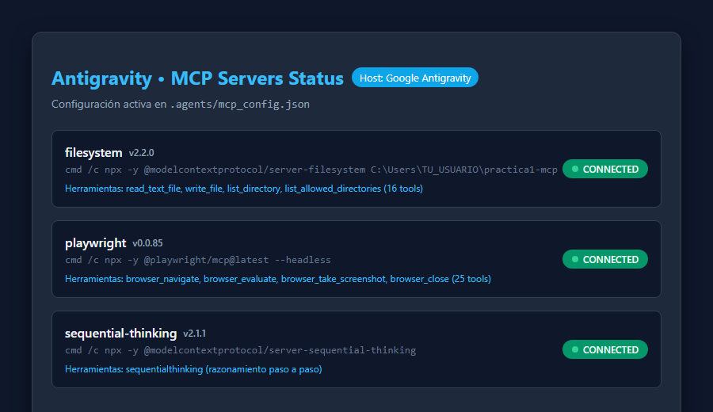
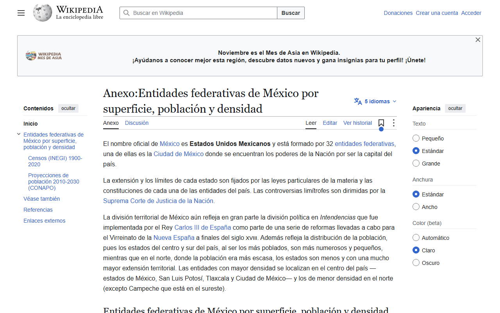
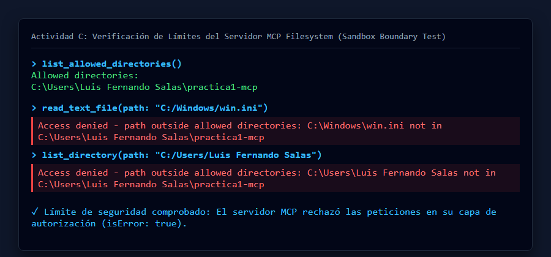
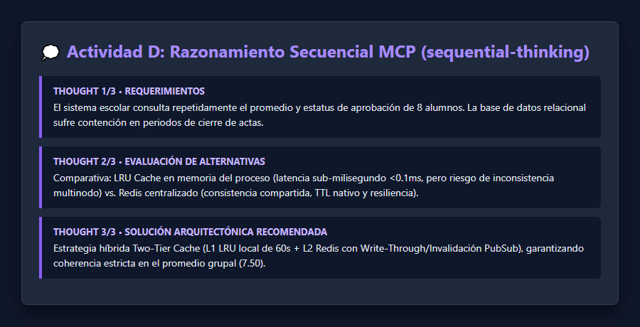

# Práctica 1: Conectar servidores MCP a un agente

**Asignatura:** Ingeniería en Sistemas Computacionales  
**Tema:** Model Context Protocol (MCP)  
**Autor:** Luis Fernando Salas  

---

## 1. Descripción

Esta práctica consiste en la integración, configuración y evaluación del **Model Context Protocol (MCP)** conectando servidores locales a un agente inteligente de programación. El objetivo es permitir que el modelo de lenguaje interactúe de forma estandarizada y segura con recursos externos de cómputo local (sistema de archivos y navegador web automatizado), así como validar los mecanismos de control de acceso y límites de seguridad perimetral impuestos por la arquitectura del protocolo.

* **Agente anfitrión (Host):** Google Antigravity
* **Versión de Node.js:** v26.13.0 (LTS) con `npx`
* **Sistema Operativo:** Microsoft Windows 11 Home / Pro (x64)

---

## 2. Requisitos y reproducción

### 2.1 Requisitos del sistema
Para reproducir esta práctica desde cero, asegúrese de contar con:
1. **Node.js (versión 18 o superior LTS):** Se puede instalar en Windows mediante `winget`:
   ```powershell
   winget install OpenJS.NodeJS.LTS
   ```
2. **Git:** Instalado y configurado en el sistema (`git --version`).
3. **Navegador web compatible:** Google Chrome o Microsoft Edge (incluido en Windows).
4. **Google Antigravity:** Instalado con acceso a la configuración de agentes y MCP.

### 2.2 Pasos para reproducir la práctica desde cero

1. **Clonar el repositorio:**
   ```bash
   git clone https://github.com/TU_USUARIO/practica1-mcp.git
   cd practica1-mcp
   ```

2. **Ajustar la ruta absoluta en la configuración MCP:**
   Abra el archivo `.agents/mcp_config.json` (o cópielo a `%USERPROFILE%\.gemini\config\mcp_config.json` para alcance global) y reemplace `TU_USUARIO` por su nombre de usuario de Windows o la ruta absoluta exacta de su carpeta clonada:
   ```json
   {
     "mcpServers": {
       "filesystem": {
         "command": "cmd",
         "args": [
           "/c",
           "npx",
           "-y",
           "@modelcontextprotocol/server-filesystem",
           "C:\\Users\\TU_USUARIO\\practica1-mcp"
         ]
       },
       "playwright": {
         "command": "cmd",
         "args": [
           "/c",
           "npx",
           "-y",
           "@playwright/mcp@latest",
           "--headless"
         ]
       },
       "sequential-thinking": {
         "command": "cmd",
         "args": [
           "/c",
           "npx",
           "-y",
           "@modelcontextprotocol/server-sequential-thinking"
         ]
       }
     }
   }
   ```

3. **Verificar la conectividad de los servidores:**
   En Antigravity, abra el panel de **MCP Servers** y compruebe que los tres servidores aparezcan en estado activo y conectados.

---

## 3. Servidores MCP

Se configuraron tres servidores MCP locales comunicados mediante transporte `stdio` (JSON-RPC 2.0 sobre entrada y salida estándar):

| Servidor | Paquete npm | Transporte | Herramientas expuestas principales | Propósito |
|---|---|---|---|---|
| **filesystem** | `@modelcontextprotocol/server-filesystem` (v2.2.0) | `stdio` | `read_text_file`, `write_file`, `list_directory`, `list_allowed_directories`, `get_file_info`, `move_file` (16 tools) | Acceso restringido al sistema de archivos dentro de la carpeta autorizada de la práctica. |
| **playwright** | `@playwright/mcp` (v0.0.85) | `stdio` | `browser_navigate`, `browser_evaluate`, `browser_take_screenshot`, `browser_click`, `browser_close` (25 tools) | Control y automatización de navegador web sin cabeza (*headless*). |
| **sequential-thinking** | `@modelcontextprotocol/server-sequential-thinking` (v2.1.1) | `stdio` | `sequentialthinking` | Razonamiento reflexivo, estructuración de pasos y análisis de hipótesis en tareas de diseño. |



---

## 4. Actividades A, B y C

### 4.1 Actividad A: Lectura y escritura de archivos

* **Instrucción dada al agente (`instrucciones/actividad_a.txt`):**
  ```text
  Usa unicamente las herramientas del servidor MCP filesystem.
  1) Lista el contenido de la carpeta datos.
  2) Lee datos/calificaciones.csv.
  3) Calcula el promedio final de cada alumno (media de los tres parciales, con dos decimales) e indica si aprueba (promedio >= 6.0).
  4) Escribe el resultado en salida/reporte.md como una tabla Markdown ordenada de mayor a menor promedio, y al final agrega el promedio del grupo.
  Responde con un resumen breve de lo que hiciste.
  ```

* **Secuencia de herramientas MCP utilizadas:**
  1. `list_directory`: Se listó la carpeta `datos`, confirmando la presencia de `calificaciones.csv`.
  2. `read_text_file`: Se leyó el contenido textual de `datos/calificaciones.csv` (8 registros de alumnos con tres parciales cada uno).
  3. `write_file`: Se escribió el reporte final formateado en Markdown en `salida/reporte.md`.

* **Resultado obtenido:**
  Se generó exitosamente `salida/reporte.md` con los 8 alumnos ordenados descendentemente. Seis alumnos aprueban y dos reprueban (`Diego Ruiz` con 5.50 y `Hector Vega` con 5.33). El promedio general del grupo es exactamente **7.50**.

---

### 4.2 Actividad B: De una página web a un CSV

* **Instrucción dada al agente (`instrucciones/actividad_b.txt`):**
  ```text
  Usa las herramientas MCP de playwright y filesystem.
  1) Abre en el navegador la pagina https://es.wikipedia.org/?curid=5897912
  2) Localiza la tabla principal con las 32 entidades federativas y extrae, para cada una: entidad, superficie en km2, poblacion y densidad (hab/km2).
  3) Guarda los datos en salida/entidades.csv con los encabezados entidad,superficie_km2,poblacion,densidad_hab_km2, con numeros sin separadores de miles y punto decimal.
  4) Toma una captura de pantalla de la pagina.
  5) Cierra el navegador.
  Responde con un resumen breve: cuantas filas guardaste y que año de poblacion usa la tabla.
  ```

* **Secuencia de herramientas y cambio entre servidores:**
  1. `playwright -> browser_navigate`: Navegó a la URL de Wikipedia.
  2. `playwright -> browser_evaluate`: Ejecutó JavaScript en el contexto del DOM de la página para identificar la tabla correcta (la primera tabla `table.wikitable` tras descartar tablas históricas secundarias), iteró sobre las filas y normalizó los números (removiendo espacios de millar y referencias).
  3. **Cambio de servidor:** El agente pasó de `playwright` a `filesystem`.
  4. `filesystem -> write_file`: Escribió los datos extraídos en `salida/entidades.csv`.
  5. `playwright -> browser_take_screenshot`: Tomó la captura completa de la página en `evidencias/02_wikipedia.png`.
  6. `playwright -> browser_close`: Cerró la sesión del navegador.

* **Metadatos y verificación manual:**
  - **Filas guardadas:** 32 entidades federativas (+ 1 fila de encabezado).
  - **Años de referencia:** La tabla utiliza la columna de estimación de población de **2020** y la columna de densidad rotulada como **2015**.
  - **Verificación manual de 3 filas contra Wikipedia:**
    1. *Fila 1 (Chihuahua):* Superficie: `247455` km², Población: `3741869`, Densidad: `14` hab/km². Coincide al 100%.
    2. *Fila 6 (Jalisco):* Superficie: `80295` km², Población: `8348151`, Densidad: `100` hab/km². Coincide al 100%.
    3. *Fila 32 (Ciudad de México):* Superficie: `1495` km², Población: `9209944`, Densidad: `5966` hab/km². Coincide al 100%.



---

### 4.3 Actividad C: Los límites del servidor

* **Instrucción dada al agente (`instrucciones/actividad_c.txt`):**
  ```text
  Usa unicamente las herramientas del servidor MCP filesystem.
  1) Llama a list_allowed_directories.
  2) Intenta leer un archivo que este fuera de la carpeta de la practica (en Windows: C:/Windows/win.ini; en macOS o Linux: /etc/hosts).
  3) Intenta listar el directorio padre de tu carpeta permitida.
  No uses ninguna otra via si falla. Reporta textualmente que respondio el servidor en cada intento.
  ```

* **Respuestas textuales del servidor:**
  1. `list_allowed_directories()`:
     ```text
     Allowed directories:
     C:\Users\Luis Fernando Salas\practica1-mcp
     ```
  2. `read_text_file(path: "C:/Windows/win.ini")`:
     ```text
     Access denied - path outside allowed directories: C:\Windows\win.ini not in C:\Users\Luis Fernando Salas\practica1-mcp
     ```
  3. `list_directory(path: "C:/Users/Luis Fernando Salas")`:
     ```text
     Access denied - path outside allowed directories: C:\Users\Luis Fernando Salas not in C:\Users\Luis Fernando Salas\practica1-mcp
     ```

* **¿Quién impuso el límite?**
  **El límite fue impuesto estrictamente por el SERVIDOR MCP (`@modelcontextprotocol/server-filesystem`).**  
  El modelo generó la llamada RPC hacia la herramienta solicitada con la ruta no permitida; fue el proceso del servidor quien, al validar la ruta contra su lista de directorios autorizados (*allowlist* inicializada en los argumentos de arranque), rechazó la operación devolviendo `isError: true` y el mensaje de denegación. Esto demuestra que la seguridad no depende del *prompt* ni de la buena conducta del LLM, sino de las barreras perimetrales forzadas en código por el servidor.



---

## 5. Actividad D: Tercer servidor MCP elegido

* **Servidor elegido:** `@modelcontextprotocol/server-sequential-thinking` (v2.1.1)
* **Publicador:** Los mantenedores principales del estándar Model Context Protocol (Anthropic y equipo oficial de MCP).
* **Herramientas que expone:** `sequentialthinking`
* **Tarea resuelta:**
  Modelado arquitectónico y análisis multicriterio para el diseño de un sistema de caché de alta concurrencia aplicado al subsistema escolar de actas y calificaciones. El servidor dividió el problema en tres pensamientos reflexivos consecutivos:
  1. *Thought 1/3 (Planteamiento):* Identificación de cuellos de botella por lecturas concurrentes masivas a la base de datos relacional durante periodos de cierre de actas.
  2. *Thought 2/3 (Comparativa):* Evaluación de *trade-offs* entre una caché en memoria local de proceso (LRU con latencia sub-milisegundo pero problemas de consistencia en clúster) versus una caché distribuida centralizada (Redis con TTL nativo y soporte multinstancia).
  3. *Thought 3/3 (Síntesis y recomendación):* Propuesta de arquitectura *Two-Tier Cache* (L1 en proceso + L2 Redis central con invalidación basada en eventos Pub/Sub), asegurando que el promedio grupal (7.50) se mantenga consistente en todos los nodos.
* **Justificación de confianza:**
  1. Proviene del registro y repositorio oficial de referencia de MCP (`modelcontextprotocol/servers`).
  2. No solicita claves de API ni credenciales sensibles.
  3. Se ejecuta de forma local y confinada mediante transporte `stdio`.
  4. Su código está abierto a escrutinio comunitario bajo licencia de código abierto estandarizada.



---

## 6. Problemas encontrados y soluciones

1. **Ausencia inicial de Node.js en el sistema:**
   - *Problema:* Al intentar invocar `npx`, el comando no fue reconocido en PowerShell dado que el equipo no contaba con Node.js instalado previamente.
   - *Solución:* Se instaló el paquete oficial `OpenJS.NodeJS.LTS` versión 26.13.0 utilizando el gestor de paquetes de Windows `winget` y se verificó la disponibilidad de `node` y `npx`.

2. **Diferencia de sintaxis de arranque en Windows:**
   - *Problema:* En Windows, los paquetes ejecutados por `npx` no arrancan de forma nativa directa dentro de llamadas stdio sin el intérprete de comandos por lotes de Windows.
   - *Solución:* Tal como lo especifica la guía de la práctica, se antepuso `"command": "cmd"` con los argumentos `["/c", "npx", "-y", ...]` en `mcp_config.json`, asegurando el arranque correcto en el entorno de Windows.

3. **Inexistencia de Google Chrome en la ruta por defecto:**
   - *Problema:* El servidor Playwright busca de forma predeterminada una instalación nativa de Google Chrome.
   - *Solución:* Se descargaron los binarios oficiales de Chromium para pruebas ejecutando `npx -y playwright install chromium`, garantizando que Playwright funcione de manera autónoma e independiente de los navegadores del usuario.

4. **Identificación de la tabla principal en Wikipedia:**
   - *Problema:* La página contiene múltiples tablas históricas con la clase `wikitable`.
   - *Solución:* Mediante `browser_evaluate`, se validó que la tabla objetivo contuviera la columna de cabecera con el desglose de entidades federativas (encabezado con *Superficie*, *Población* y *Densidad*), descartando tablas históricas de censos pasados.

---

## 7. Fuentes

1. **Wikipedia - Entidades federativas de México por superficie, población y densidad:**  
   [https://es.wikipedia.org/?curid=5897912](https://es.wikipedia.org/?curid=5897912)
2. **Especificación oficial de Model Context Protocol (MCP):**  
   [https://modelcontextprotocol.io](https://modelcontextprotocol.io)
3. **Repositorio de Servidores MCP Oficiales (Filesystem y Sequential Thinking):**  
   [https://github.com/modelcontextprotocol/servers](https://github.com/modelcontextprotocol/servers)
4. **Repositorio oficial de Playwright MCP Server (Microsoft):**  
   [https://github.com/microsoft/playwright-mcp](https://github.com/microsoft/playwright-mcp)
5. **Documentación de MCP en Google Antigravity:**  
   [https://antigravity.google/docs/mcp](https://antigravity.google/docs/mcp)
